<p align="center">
  
</p>

<p align="center">
  
</p>

<p align="center">
  <a href="https://linkedin.com/in/mehmet-furkan-akyar/" target="_blank">
    
  </a>
  <a href="mailto:mehmetfurkan.akyar@gmail.com">
    
  </a>
</p>

---

### 👨‍💻 About Me

```java
public class MehmetFurkan extends Student {

    private final String university = "Fırat University";
    private final String department = "Software Engineering";
    private int          year       = 2;

    private String[] currentFocus      = { "OOP", "Database Systems" };
    private String[] currentlyLearning = { "Java", "C#", "SQL" };
    private String[] hobbies           = { "Games 🎮", "Travel ✈️", "Cinema 🎬", "Ski ⛷️" };

    public String getMotto() {
        return "It works on my machine."; // 🤷‍♂️
    }
}
```

<p align="center">
  
</p>

### 🚀 Featured Projects

<table>
  <tr>
    <td width="50%" valign="top">
      <h4>🍳 <a href="https://github.com/mehmet-furkan/YMT-Akilli-Yemek-Tarifi-Web-Uygulamasi">Night Code Kitchen</a></h4>
      Tell it what's in your fridge, it tells you what to cook.
      <br/><br/>
      Built with a 6-person team in my first year — and I was the project manager. 📋
    </td>
    <td width="50%" valign="top">
      <h4>📵 <a href="https://github.com/mehmet-furkan/Shorts-Blocker">Shorts Blocker</a></h4>
      An Android app that kicks me out of YouTube Shorts and Instagram Reels once my daily limit is up.
      <br/><br/>
      Yes, I needed it. Yes, it works. 😅
    </td>
  </tr>
</table>

### 🧰 Tools I've Used

<p align="left">
  
</p>

<p align="center">
  
</p>

<p align="center">
  
</p>
